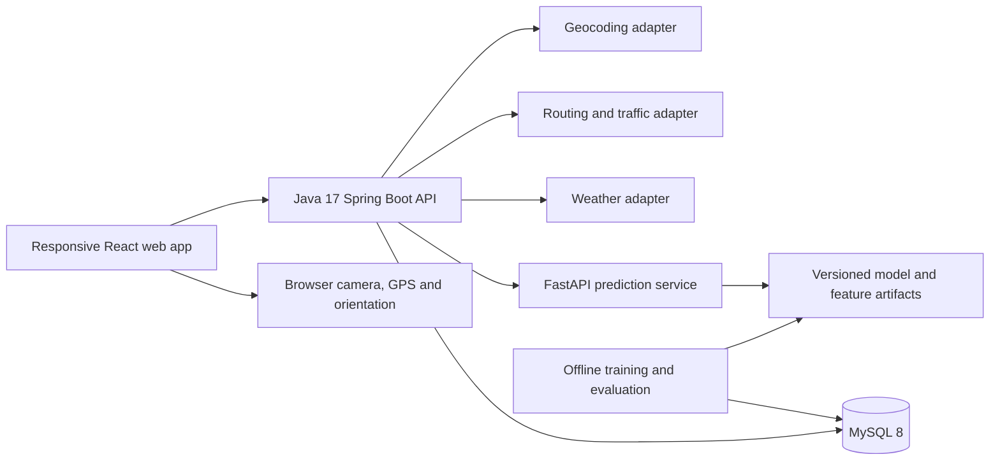

# TrafficEase nationwide system architecture

Status: target architecture, not a claim of implemented functionality. The updated nationwide requirements supersede the earlier Colombo-first product scope. Working branch: `vidura`; preserve the navy/yellow responsive design. Never modify `main` as part of this work.

## Inspected implementation

The repository currently contains React/Vite/Tailwind UI with fixed Colombo Fort–Wellawatte sample cards and an SVG schematic; Java 17 / Spring Boot 3.5.7 with `/api/health`; FastAPI with `/health` reporting `not_trained`; and a MySQL 8 bootstrap schema. The services are not connected to the UI or database. No geographic search, routing provider, traffic feed, model training, sensors, authentication or AWS deployment exists. Existing screenshots and test results document that foundation, not the target capabilities below.

## Components and boundaries

Frontend owns location selection, departure controls, maps, comparisons, forecasts, live-information views and camera overlays. It never fabricates routing results or stores server credentials. Spring Boot owns validation, country restriction, provider adaptation, comparison, capability reporting, rate limits and error normalization. FastAPI owns model inference and model metadata; offline Python jobs own dataset creation, training and evaluation. MySQL stores permitted first-party road/observation data and experimental predictions. External geocoder, routing, map and weather services remain replaceable and independently licensed.

## Nationwide geography

Search origins and destinations anywhere in Sri Lanka, including Sinhala/Tamil/English names where the selected geocoder supports them. Use explicit result selection with display name, provider place identifier, WGS84 coordinates and country code. Country filtering must be backed by returned metadata or validated boundaries; a rectangular bounding box alone does not prove a location is inside Sri Lanka. Colombo can remain a sample journey, never a search restriction.

Use GeoJSON `[longitude, latitude]` consistently and validate coordinate ranges and snapped-road distance. Ambiguous search, no matching road, disconnected road graphs and unmapped regions return explicit states. Nationwide product scope does not imply complete map, traffic or model coverage. Report coverage per capability, geography, requested time and source. Do not infer reliable traffic from the existence of a mapped road.

## Journey time rules

Use `Asia/Colombo` for user-facing dates and departure entry; serialize offset-aware timestamps and persist UTC instants. Server time is authoritative. Accept departures from now through a rolling seven-day horizon (`now + 7 days`, inclusive); also constrain the UI to local dates through today plus seven. Do not accept a later time on that final day beyond the rolling horizon. An injected clock makes boundary tests deterministic.

- `LEAVE_NOW`: server resolves departure when processing the request.
- `LATER_TODAY`: explicit future time on the current Sri Lankan calendar date; 10 AM → 7 PM is valid.
- `FUTURE_DATE`: explicit future local date and time within the same seven-day horizon. Today uses Later Today.

Reject past, invalid, missing or inconsistent times. UI selection cannot promise provider support: return capability limitations for unsupported traffic forecasts. A static route can be offered separately with a prominent non-traffic label, never relabeled as a forecast. Re-evaluate expired selections before submission.

## Routing and provenance

Proposed endpoints (not implemented):

| Endpoint | Responsibility |
| --- | --- |
| `GET /api/capabilities` | Configured sources, regions, forecast horizons, attribution and availability |
| `GET /api/locations?query=...` | User-triggered Sri Lankan geographic search |
| `POST /api/routes` | Selected locations, journey mode/time, car profile; genuine geometry and comparisons |
| `GET /api/traffic` | Available observations/current provider information with timestamps |
| `POST /api/forecasts` | Road/region, time and experimental-model inference |
| `POST /predict` (internal FastAPI) | Validated feature inputs and model metadata |

Routing responses include request/departure timestamps, source/provider, returned route identifiers, geometry, meters, seconds, attribution and capability warnings. Each duration has one explicit provenance kind:

| Kind | Meaning |
| --- | --- |
| `PROVIDER_CURRENT_TRAFFIC` | Provider traffic-aware estimate for a current departure |
| `PROVIDER_FUTURE_ESTIMATE` | Provider explicitly supports the requested future departure |
| `BASELINE_ROUTING_ESTIMATE` | Real road-graph calculation without traffic awareness |
| `EXPERIMENTAL_AI` | Synthetic or otherwise experimental model output, separately displayed |
| `UI_DEMO` | Fixed illustration only; excluded from genuine route comparison |

Include `generatedAt`, `observedAt` when applicable, `departureAt`, `experimental`, coverage status and limitations. Unknown timestamps remain unknown. Provider/model errors must not fall back silently to demo cards. Model congestion categories cannot become journey durations without a separately evaluated duration model.

Select minimum duration and minimum distance independently across genuine returned candidates. Permit both labels on one route; return all ties, stable ordering and no invented alternatives. Label results **fastest/shortest among returned routes** unless the engine actually optimizes those objectives. A fastest-route engine's alternatives cannot establish the globally shortest road path. A dedicated shortest-distance request/engine is required before making that stronger claim. Time savings compare compatible estimates for the same departure, profile and source; avoid spurious precision and differences across unrelated forecasts.

## Provider selection gate

Choose geocoding, routing, tiles and traffic sources separately. Before connecting a service, record official terms/documentation URLs, review date, Sri Lankan coverage evidence, supported profiles/objectives, alternative-route limits, traffic support, future horizon, attribution, caching/storage/display restrictions, quotas, cost and required credentials. No paid subscriptions or credentials are assumed or created.

An OpenStreetMap-based engine is a candidate for genuine baseline road routing, not evidence of live traffic or guaranteed shortest-distance optimization. Public demo endpoints are not a production entitlement or SLA. Google Routes is an evaluation candidate, not a selected or verified nationwide traffic source. Validate coverage with real requests outside Colombo; a single success proves only that request. Map tile compatibility and provider display requirements must be checked together. Unsupported regions/times remain explicitly unavailable.

## Forecasting and data design

Initially generate hypothetical Sri Lankan scenarios with an explicit synthetic source. Features may include road class/lanes, local hour, weekday, weather and available historical measurements. Future weather must come from a forecast or labeled scenario; do not reuse current weather as future fact. Return low/moderate/high congestion, model version, feature provenance, target time, training source and coverage status. Do not imply calibrated confidence without calibration evidence.

Train offline with reproducible seeds and recorded dataset/model versions. Evaluate with leakage-aware time/road splits, confusion matrix, macro-F1 and per-class recall; report synthetic-only evaluation prominently. Real Sri Lankan validation is a separate release gate. Reject missing/unsupported features, out-of-distribution regions and untrained models with meaningful responses. Nationwide scope must never be implemented by blindly extrapolating a Colombo-only model.

The current schema is only a bootstrap: replace the implicit Colombo district default in a versioned migration; add explicit region/province/district identifiers, road geometry/provider mappings, observation quality, source/license metadata, model registry, training/evaluation records, forecast inputs and coverage metadata. Keep restricted provider payloads transient unless licensed retention is established. Apply migrations without resetting existing data. An admin role later manages permitted observations/roads and audits predictions; public users cannot edit those records.

## AR and reliability

Ask for camera/GPS/orientation access only after a user action in HTTPS. Combine GPS accuracy, heading accuracy/freshness and nearby mapped road bearings to produce candidate directions; GPS alone never visually recognizes roads. Require a selected destination and departure before evaluating routes. Keep overlays tied to the same route geometry, provenance and time context as the planner. Distinguish current estimates from later forecasts and experimental predictions.

Handle compass unavailable, denied permissions, stale fixes, ambiguous parallel roads, poor accuracy, indoor use, unsupported browser and route failure. Allow manual candidate selection and a map fallback; withhold directional claims/time savings when alignment is unreliable. Pause camera/tracking when leaving the view and release streams/listeners. Make stationary/passenger use explicit; no driver interaction flow. Evaluate AR.js/A-Frame only if needed by the overlay approach; library inclusion alone is not functional AR. Test on actual Android and iOS devices.

## UI, resilience, security and privacy

Preserve existing styling and accessible responsive navigation. Every data view needs idle, loading, success, empty, unsupported, stale and error states, plus keyboard access and readable source labels. Abort stale requests so old responses cannot overwrite newer locations or departure times. Live information is unavailable until an actual feed is verified.

Backend adapters enforce timeouts, bounded retries, quota limits, validated response shapes, bounded search input and safe upstream URLs. Keep secrets server-side and redact keys and precise journey locations in logs. Configure explicit allowed frontend origins or same-origin API proxying. Minimize location retention, request consent for saved journeys, and protect admin endpoints with role-based authentication. Do not send camera frames to a service by default.

## AWS target, operations and release gates

Proposed deployment: static frontend on S3/CloudFront; containerized Spring Boot and FastAPI behind an HTTPS entry point on ECS/Fargate; private RDS MySQL; private versioned model artifacts in S3; Secrets Manager, least-privilege IAM and CloudWatch monitoring. Keep AI/database private and restrict inference to the backend. Validate regional availability, pricing, TLS, backups, migrations, rollback, spend limits and a threat model before provisioning. No deployment is authorized by this document.

CI should run frontend build and meaningful browser checks, Java 17 Maven tests, Python tests, migration integration checks and adapter contract tests. Separate offline mocked tests from real upstream smoke tests; mocked success never establishes geographic coverage. Monitor latency, provider errors/quota exhaustion, coverage misses and model/data drift without logging sensitive journeys. Health must distinguish process liveness from provider/database/model readiness.

See [milestones.md](milestones.md) for delivery order and [requirements.md](requirements.md) for acceptance requirements.
