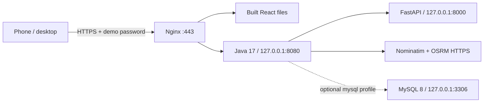

# Amazon Linux 2023 EC2 deployment guide

**Primary target: Amazon Linux 2023 x86-64, Corretto JDK 17, Python 3.12, Node 22, Maven, Nginx and systemd.** This is preparation, not an AWS deployment. No AWS resources, credits, credentials or public certificate orders were used. All console/host commands below are future operator steps. Work only from `vidura`. The previous [Ubuntu implementation](ec2-ubuntu-deployment.md) is retained under `infra/ec2-ubuntu/`; do not mix platform installers or overwrite an existing host.

## Architecture and capacity



Recommend **2 vCPU / 4 GiB RAM**, e.g. regionally available `t3.medium`/`t3a.medium` with **Standard CPU credits**, and **30 GiB encrypted gp3**. This is a capacity estimate, not an EC2 benchmark. Build/train sequentially. Java is capped at 1 GiB with 512 MiB heap; AI uses one worker capped at 1 GiB. Allow OS/Nginx/cache and transient build overhead. Optional MySQL adds a Docker daemon plus database memory; use its 128-MiB buffer pool/20-connection settings and measure total RAM before enabling it on a 4-GiB host. Leave the database off for the cheapest demonstration. Do not force all services/builds onto 1–2 GiB RAM; a 2-GiB instance needs off-host builds and separate capacity testing, with no MySQL.

One host means brief update downtime and no redundancy/SLA. No GPU, load balancer, NAT Gateway, ECS, RDS, S3 website, Route 53 hosted zone, Secrets Manager, CloudWatch agent, automatic snapshots or extra Elastic IP is required. No AWS CLI/IAM role is needed by the application.

## Cost and Free Plan gate

**Actual eligibility and remaining credits cannot be verified without your console; do not assume any instance is free.** Before launch, check the selected region/type against your AWS Free Plan, credit balance, expiry and payment/upgrade terms. Use the regional AWS calculator and official [EC2](https://aws.amazon.com/ec2/pricing/on-demand/), [EBS](https://aws.amazon.com/ebs/pricing/), [IPv4](https://aws.amazon.com/vpc/pricing/) and [Free Tier](https://aws.amazon.com/free/) pages. The cloud proxy blocks live AWS pricing verification here.

Illustrative Linux US-East assumptions, **not current regional quotes**: t3.medium $0.0416/hour, 30 GiB gp3 at $0.08/GiB-month, one public IPv4 at $0.005/hour. At 730 hours: $30.37 + $2.40 + $3.65 = **$36.42/month**, before tax, egress, snapshots and other charges. At 40 running hours/month: ~$1.66 compute + $0.20 IPv4 + $2.40 retained disk = **$4.26/month**, before extras. A t3.small example is ~$21.23 continuously but is not the recommended build host. Budget roughly $30–50 for an always-on 4-GiB host until actual regional prices are checked. Amazon Linux itself has no separate paid AMI license in this proposal.

Choose **Standard**, not Unlimited CPU credits, to avoid surplus-credit billing; Standard may throttle. Minimize active hours. Budget alerts, if your plan supports them, are not spending caps; review their terms and check billing after the first session. No billing automation or paid service is created by this repository.

## 1. Manual EC2 and networking setup

1. Review credits/pricing first. In EC2 Console select the official Amazon-owned **Amazon Linux 2023 x86-64** AMI, 2-vCPU/4-GiB instance, Standard CPU credits, 30-GiB encrypted gp3, a public subnet/Internet Gateway and automatic public IPv4. No paid Marketplace AMI, unnecessary provisioned IOPS or IAM role. Require IMDSv2; metadata hop limit 1.
2. Use an existing SSH key stored securely on your laptop, outside Git/chat. Do not request/upload AWS access keys or put secrets in EC2 user-data.
3. Initial security group: **TCP 22 from your current admin IP `/32` only**. Later allow 443 for intended demo viewers (or public with the password gate). Port 80 must be reachable by the public CA for HTTP-01 issuance/renewal. **Never expose 8000, 8080, 3306 or 33060.** No IPv6 is configured by these templates; omit AAAA records unless IPv6 networking/SG/listeners are deliberately prepared.
4. Allow outbound DNS and HTTP/HTTPS for signed Amazon Linux packages, official tool downloads, PyPI/npm/Maven, Nominatim/OSRM and certificate issuance/validation. Browser tiles load from OSM directly. The default EC2 outbound rule is easiest for a beginner; review restrictions before changing it.
5. Point an existing DNS hostname's A record to the public IPv4. Use your current DNS provider; no domain purchase/Route 53 service is created. Connect with `ssh -i /path/to/existing-key.pem ec2-user@PUBLIC_IP` (protect the local key permissions). Amazon Linux uses **ec2-user**, not ubuntu.

## 2. Prepare a fresh host

Do not use the installer on existing production infrastructure. It refuses an existing Nginx configuration without its own AL2023 marker. Review any existing workload manually; never remove unrelated sites to bypass this guard.

```sh
sudo dnf upgrade --refresh -y   # review updates; reboot first if needed
sudo dnf install -y git
cd ~
git clone --branch vidura https://github.com/ushanp02-maker/TrafficEase.git
cd TrafficEase
sudo bash infra/ec2/install-host.sh ec2-user
```

The installer uses signed `dnf` packages: Corretto 17 devel, `python3.12`/`python3.12-pip`, Nginx, httpd-tools and utilities. It does not replace Amazon Linux's system Python 3.9. Application venv creation explicitly uses **python3.12**. Node 22.23.4 and Maven 3.9.11 use official HTTPS distributions and published checksum verification. Certbot 5.9.0 and its tested dependency set have a separate `/opt/trafficease-certbot` venv/lockfile. Review tool/security updates before launch; no dependency policy substitutes for a vulnerability review. TLS/APT/RPM verification must never be disabled.

It creates a locked `trafficease` runtime user, root-controlled release directories and root-owned 0640 `/etc/trafficease/backend.env` and `ai.env` **only if absent**. Build as ec2-user, not root. Runtime cannot modify sealed code/model. Existing env files are preserved. No database credential is created or committed. Default bindings are loopback; FastAPI is not a public Nginx target.

AL2023 layout is `/etc/nginx/conf.d/trafficease.conf`, worker user/group `nginx`, and `/usr/lib/jvm/java-17-amazon-corretto.x86_64`. A minimal provided main Nginx file avoids its stock inline default server. The installer preserves the original file, uses a platform marker for repeat runs, installs systemd units and caps journal growth. Where SELinux is active, it keeps enforcement and configures static-content contexts plus the proxy boolean; verify actual AVC denials on the host rather than disabling SELinux. No service is exposed until SG/DNS/HTTPS are configured.

## 3. Build and activate

```sh
cd ~/TrafficEase
release_id="$(date -u +%Y%m%dT%H%M%SZ)-$(git rev-parse --short=12 HEAD)"
sudo bash infra/ec2/reserve-release.sh "$release_id" "$(id -un)"
bash infra/ec2/build-release.sh "$release_id"
sudo bash infra/ec2/configure-http.sh traffic.example.org
sudo bash infra/ec2/activate-release.sh "$release_id"
sudo python3 infra/ec2/health.py
```

Replace the hostname. Builds require a clean committed `vidura` checkout and matching release ID. Only committed files are archived. Node tests/build, Maven verification, locked Python install, synthetic model generation/training and Python tests run before a ready manifest is created. No ignored `.env`, private key or model from a laptop is packaged. The trusted model is generated **offline** because artifacts are excluded from Git. Raw training data and duplicate build/dependency outputs are pruned. No public-provider load tests are part of training/builds. Full Playwright regressions belong on the development machine, avoiding browser installation on the small EC2 host.

Build directly at `/opt/trafficease/releases/<id>` as ec2-user; never relocate its Python venv afterward. Activation verifies the ready/integrity manifest, seals ownership, switches `current` atomically and restarts actual systemd services. It checks model readiness, Java → FastAPI inference, optional DB availability and internal listeners. Failed activation restores the old release; failed builds do not switch it. First install has no previous release. This is not zero downtime or a signed supply-chain artifact system.

Initial HTTP serves only ACME challenge files and otherwise 503; it does not expose the application/password over plaintext. Review `ss -ltnp`: internal app ports must be loopback-only. `systemd-analyze verify`/container application success does not prove boot, SELinux or resource limits on a real instance.

## 4. Trusted HTTPS and smartphone testing

Before issuing: valid DNS, correct A record, no incorrect AAAA, SG/host firewall allowing 80 and 443, and a configured ACME site.

```sh
sudo htpasswd -cB /etc/trafficease/demo.htpasswd demo  # interactive; no password argument
sudo bash infra/ec2/enable-https.sh traffic.example.org YOUR_CONTACT_EMAIL
curl --user demo https://traffic.example.org/api/health  # prompts for password
sudo /opt/trafficease-certbot/bin/certbot renew --dry-run
sudo systemctl status trafficease-certbot.timer
```

The future operator explicitly initiates a Let's Encrypt order/accepts its terms; none was placed during preparation. Certbot uses webroot, followed by validated Nginx TLS configuration, a renewal reload hook and a twice-daily randomized systemd timer. No paid certificate is needed. Do not commit private keys, certificates, htpasswd or host env files. Add later users with `htpasswd -B` without `-c` so existing users are retained.

Nginx serves only built `frontend/dist`, protects UI **and API** with Basic auth, preserves `/api` when proxying to Java and strips Basic credentials upstream. API access logs are disabled to avoid location query logging. TLS 1.2/1.3, short HSTS, CSP, anti-framing, sensor Permissions-Policy and OSM-compatible Referrer-Policy are supplied. Keep the tile host in `img-src` if changing maps. The browser uses same-origin HTTPS; private HTTP hops are not mixed content.

Camera/GPS/compass require trusted HTTPS on the real hostname (or localhost for simulation). An HTTP public IP, self-signed warning bypass or disabled TLS check is not valid device evidence. Run the [M4 phone checklist](m4-ar-navigation.md). Scheduled departures intentionally use map planning, not future camera recommendations. No real-world alignment/turn-by-turn accuracy has been verified.

## 5. Optional MySQL 8 profile

Default: database **off**, no JDBC connection or startup dependency. The optional installer adds backend ordering after authenticated database readiness; disabling/removing that profile should also remove its optional systemd drop-in if the database is no longer wanted. Enable only if shared synthetic history helps the demonstration and RAM/disk measurements permit. AL2023's MariaDB packages are **not MySQL 8**; this implementation uses a digest-pinned official MySQL 8.4 LTS container, managed by systemd, loopback-published **only** on 3306, X plugin disabled, 128-MiB buffer pool and 20 connections. Docker is installed only by this optional action. The two dedicated secret files are read-only bind mounts with private SELinux relabeling (`:Z`); no whole host configuration directory is relabeled. Verify this on the actual host. No cloud database or paid storage service is created.

The operator must provision two locally generated root-owned 0600 secret files, never paste them into chat/Git. Example future host commands (run locally in an interactive root shell, never with shell tracing):

```sh
sudo -i
umask 077
openssl rand -base64 36 > /etc/trafficease/mysql-root-password
openssl rand -base64 36 > /etc/trafficease/mysql-app-password
exit
sudo bash infra/ec2/install-mysql.sh
sudo systemctl status trafficease-mysql
```

First startup creates only database `trafficease` and its schema-scoped app account. Existing volumes keep their credentials: changing files is **not** a password rotation. The installer refuses an unmanaged named container or volume; never delete volumes to fix credentials. Docker volumes/images are disk usage, not a separately provisioned AWS service. Keep Docker access limited to root; membership in its group is effectively root access.

Use `sudoedit /etc/trafficease/backend.env` to add the following metadata and set `DB_PASSWORD` to the locally held app secret **in that protected file only**, using your editor, not a CLI argument:

```text
SPRING_PROFILES_ACTIVE=mysql
DB_URL="jdbc:mysql://127.0.0.1:3306/trafficease?connectionTimeZone=UTC&forceConnectionTimeZoneToSession=true&sslMode=DISABLED&allowPublicKeyRetrieval=true"
DB_USER=trafficease
```

Do not put these secrets in Vite variables. Restart only the backend, then run health. Flyway V1 creates a dedicated synthetic history table; it does not turn the old schema into observed data. Existing legacy bootstrap tables can be baselined at version 0 and are preserved. Schema-scoped DDL privileges support migrations; no global MySQL privileges or public SQL account is required. Hikari has at most two connections. Startup fails honestly if the explicitly enabled database profile cannot connect/migrate. The default no-DB profile still serves routes/AI/AR without MySQL. See [persistence design/tests](persistence.md).

## 6. Updates, rollback, backup and safe shutdown

```sh
cd ~/TrafficEase
bash infra/ec2/update.sh        # clean vidura, fast-forward pull, build/test, activate
sudo bash infra/ec2/rollback.sh # restore previous code/model/frontend
sudo python3 infra/ec2/health.py
sudo bash infra/ec2/prune-releases.sh          # dry run
sudo bash infra/ec2/prune-releases.sh --apply # review first; keeps current/previous/newest 3
sudo bash infra/ec2/backup-mysql.sh            # optional DB only
```

Env, systemd and Nginx changes require separate review; update does not silently overwrite them. Rollback does not undo schema migrations, secrets, units or proxy changes. V1 is additive; future migrations must remain backward-compatible or include tested restore plans. Do not rename ready releases/venvs. Failed/incomplete builds can be inspected and manually removed only after confirming they are not active.

Backups are root-only transactional gzip dumps under `/var/backups/trafficease` with partial files removed on failure. Copy encrypted verified backups securely off-host and test restoration before valuable data exists. Local files/volumes are not disaster recovery. Back up protected env/certificate keys separately, never inside the public frontend or an unencrypted shared dump. Model artifacts can be regenerated from matching code/locks. No snapshot schedule/S3 backup subscription is created; snapshots, retained EBS and remote storage may charge.

Operational commands: `sudo systemctl status nginx trafficease-ai trafficease-backend`, `sudo journalctl -u trafficease-backend -u trafficease-ai -n 80 --no-pager`, `sudo nginx -t`, `sudo python3 ~/TrafficEase/infra/ec2/health.py`, `free -h`, `df -h`, `sudo ss -ltnp`. Journal retention is bounded; default Nginx log rotation remains relevant. Avoid sharing secrets/personal-location logs. No paid monitoring is enabled.

When finished, save/back up work, stop app units (and optional `trafficease-mysql`), then **EC2 Console → Stop instance**. Do not terminate until backups are verified. Compute stops billing; EBS, snapshots and retained Elastic IPs can continue charging. Automatic public IPv4 normally changes after stop/start: update DNS before phone tests/renewal. Confirm no unused volumes/IPs/NAT gateways/load balancers remain. Enabled services start on normal boot; renewal requires a running host/correct DNS/port 80. Long stops can let certificates expire. Stopping app processes alone does **not** stop EC2 compute billing.

## Troubleshooting and release limits

- `dnf` fails: verify current AL2023 release, signed repo access, DNS/proxy/CA and `cdn.amazonlinux.com`; do not disable signature/TLS validation. Container policy blocked that host during preparation.
- Java/Python path: verify `javac -version` is Corretto 17 and `python3.12 --version`; never repoint system `python3`. Venv paths must stay at their final release location.
- Nginx 502/403: check unit/loopback port, root permissions and SELinux AVCs. Never open 8080/8000 publicly or disable SELinux as a shortcut.
- AI unavailable: regenerate trusted artifacts with the build script; verify metadata/checksum/library versions. Never load an untrusted pickle or substitute fake outputs.
- MySQL profile fails: check unit, first-start logs, secret permissions/unchanged volume credentials, Flyway validation and memory. Disable the optional profile for a no-DB demo; preserve the volume rather than deleting data.
- Certificate fails: check DNS/AAAA/80/webroot/CA limits and timer/hook. Do not use `-k` or an invalid certificate for smartphone evidence.
- OOM/disk/CPU throttling: inspect local journals and capacity; keep 4 GiB, avoid concurrent builds/MySQL if necessary, prune reviewed releases, use Standard credits and recheck cost before resizing.
- Public providers 429/503: wait, retain explicit errors and respect limits; do not retry in loops or manufacture routes.

Nominatim, OSRM demo and OSM tiles are appropriate **only for this deliberately chosen low-volume coursework demonstration**, subject to [the recorded policies](m1-routing.md). One backend process/global limits, explicit geocoder Search buttons, caching/identification/attribution and browser Referer remain required. OSRM is reasonable non-commercial use at ≤1 request/second, with no uptime/data guarantee. Larger/public production usage needs reviewed hosted/self-hosted providers/shared limits. Synthetic forecasts are never real traffic or route ETAs.

Read [current validation](ec2-validation.md) and [implementation matrix](implementation-status.md) before declaring launch readiness. Exact manual gates remain: account/region cost verification, real host install/boot/SELinux/resource-limit checks, SG reachability, DNS/trusted certificate/renewal, backup restore and physical Android/iOS validation. These files neither authorize nor prove a deployed AWS site.
