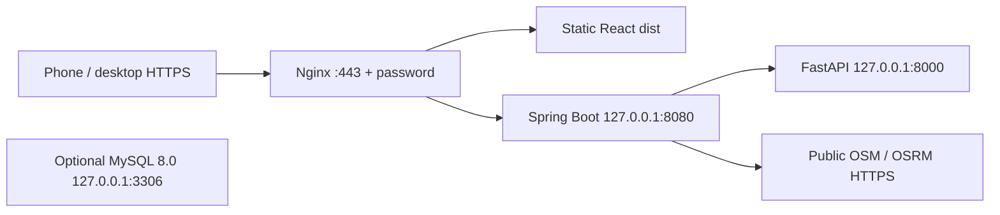

# Single-instance EC2 deployment guide (readiness, not a deployment)

This prepares TrafficEase on **Ubuntu Server 24.04 LTS x86-64**, using **Java 17**, Python 3.12, Node 22 and systemd/Nginx. No AWS resource, account connection, paid purchase, certificate order or deployment has been made by the agent. All cloud-console and host-changing commands below are future operator actions. Work from `vidura`; never merge into or alter `main` for deployment.

## Proposed architecture and resource budget



Use one public-subnet EC2 instance with an Internet Gateway, encrypted gp3 root volume and no NAT Gateway, load balancer, RDS, ECS, S3 website, Route 53 hosted zone, CloudWatch agent, automatic EBS snapshot schedule or extra Elastic IP. Use an existing domain/DNS provider where available. Optional MySQL is **not integrated with the current application**, so leave it uninstalled unless needed for coursework/schema work.

| Item | Recommendation / estimate |
| --- | --- |
| Instance | `t3.medium` or regionally available `t3a.medium`, x86-64, 2 vCPU / 4 GiB RAM; select **Standard** CPU credits, not Unlimited |
| Lower-memory alternative | 2 vCPU / 2 GiB (`t3.small` / `t3a.small`) only after memory testing, preferably with builds/training elsewhere and no MySQL; not the recommended on-instance build target |
| Disk | 30 GiB encrypted gp3 recommended for OS/toolchains, dependency caches, 3 releases, model artifacts and logs; 20 GiB may fit but requires more pruning |
| Runtime memory budget | Java heap 512 MiB plus native overhead (service cap 1 GiB); AI one worker (cap 1 GiB); OS/Nginx/caches roughly 0.5–1 GiB; optional MySQL needs extra memory |
| Build/training headroom | Node build limited to 768 MiB old-space, Maven heap 512 MiB, synthetic training uses two threads; simultaneous old services + build/train can exceed 2 GiB |
| Availability | Single host, short service interruption during activation, no redundancy or SLA. Standard T3 CPU throttles after credits are exhausted |

These are capacity estimates, not an EC2 load benchmark. Training has only 77,760 synthetic rows; runtime serves a small Random Forest, not a GPU/LLM. No GPU, large instance or paid AI API is needed. Load-test locally without hitting donated OSM services before raising user counts.

## Cost and Free Plan constraints

**Do not assume the instance is free.** Check your AWS Billing/Free Tier console for actual remaining credits, expiry, account plan, eligible instance types and region before launching. Newer AWS Free Plans/credit terms differ from legacy EC2 free-hour offers. Credits may not cover every charge, and upgrade/payment terms are account-specific. No balance or eligibility was queried here and no AWS credentials are needed for this repository preparation.

Planning examples using illustrative US-East on-demand Linux rates (not a current quote):

| Continuous 730-hour month | Compute assumption | 30 GiB gp3 assumption | One public IPv4 assumption | Approximate subtotal |
| --- | --- | --- | --- | --- |
| 2 GiB `t3.small` | $0.0208/h = $15.18 | $0.08/GiB-month = $2.40 | $0.005/h = $3.65 | **$21.23/month** |
| 4 GiB `t3.medium` | $0.0416/h = $30.37 | $2.40 | $3.65 | **$36.42/month** |

For the recommended host running 40 hours/month, the same assumptions give ~$1.66 compute + $0.20 automatic public IPv4 while running + $2.40 retained EBS = **~$4.26**, before taxes, transfer, snapshots and other charges. Regions (including Mumbai), `t3a`, Windows/other AMIs and pricing changes differ. Budget roughly **$30–50/month** for always-on 4 GiB usage until you verify a regional calculator estimate. Do not select paid AMIs/Marketplace images or oversized provisioned disk throughput/IOPS.

Official references to check before launch: [EC2 on-demand](https://aws.amazon.com/ec2/pricing/on-demand/), [EBS](https://aws.amazon.com/ebs/pricing/), [public IPv4](https://aws.amazon.com/vpc/pricing/), [Free Tier](https://aws.amazon.com/free/) and [AWS calculator](https://calculator.aws/). The cloud proxy denied the AWS pricing page during preparation, so live regional rates were **not independently verified**. These assumptions must not be presented as guaranteed current prices.

Use **Standard** T3 CPU credits to avoid Unlimited surplus-credit charges; expect throttling rather than extra CPU billing. Minimize active hours and retained volumes. Set a very small billing alert/budget if your plan supports it, but review any alert-service costs; a budget alert is **not a spending cap or automatic shutdown**. Check billing after the first short session. No budget/scheduler/IAM/AWS service is provisioned by these files.

## 1. Manual AWS preparation (do not perform until ready)

1. Review remaining credits, plan expiry and the regional price estimate. Enable MFA for your human AWS account; do not create/upload access keys for these scripts.
2. In EC2 Console choose the official Canonical Ubuntu **24.04 LTS x86-64** AMI, one eligible 2-vCPU/4-GiB instance, Standard CPU credits, 30-GiB encrypted gp3 and a public subnet/automatic public IPv4. Do not attach an IAM role: this app does not call AWS APIs. Require IMDSv2 and use metadata hop limit 1. Do not put secrets in user-data.
3. Download/use your existing SSH key securely outside Git. Initial security group: **TCP 22 only from your current admin public IP `/32`**; never world-open SSH. Do not open 8000, 8080, 3306 or 33060. For a demo you can restrict 443 to known viewers' networks; otherwise public 443 is password protected. Open 80 only when the ACME site is configured and certificate issuance/renewal needs it. Public HTTP-01 renewal requires CA reachability on 80.
4. Outbound DNS plus HTTP/HTTPS package/provider/certificate traffic is needed. The EC2 security-group default outbound rule is simplest for a beginner; do not block Ubuntu mirrors or certificate validation without understanding the dependencies. Backend public service destinations are the existing Nominatim/OSRM hosts; browser map tiles come directly from OSM.
5. SSH as `ubuntu`, not root, using the correct region/address/key. Point an existing DNS hostname to the instance's public IPv4. Do not add an AAAA record unless IPv6 networking/listeners/SG are explicitly prepared (these templates listen on IPv4). DNS must resolve correctly before certificates. Route 53 is optional and incurs separate charges; no domain purchase is required by the scripts.

## 2. Prepare the host

Clone the public repository as the normal SSH user. No GitHub/AWS token belongs on the host for this public checkout:

```sh
sudo apt-get update
sudo apt-get install -y git
cd ~
git clone --branch vidura https://github.com/ushanp02-maker/TrafficEase.git
cd TrafficEase
sudo bash infra/ec2/install-host.sh ubuntu
```

The installer checks Ubuntu 24.04 amd64, installs official signed Ubuntu packages, Java 17, Python 3.12/venv, Nginx, Certbot and tools. Node 22.23.4 and Maven 3.9.11 are installed from official HTTPS distributions with published checksum verification. TLS/APT signature verification is never disabled. Review/update these pinned versions for security patches before deployment; readiness is not a formal vulnerability audit. No application source/dependency versions are upgraded implicitly.

It creates a locked `trafficease` runtime user, root-controlled release directories and `/etc/trafficease/{backend,ai}.env` from templates **only if absent**. The runtime user has no sudo and cannot modify its sealed code/model. No AWS tooling or credentials are installed. Standard package installation may start Nginx; keep port 80/443 closed in the security group until configuration below. The stock default site is removed. MySQL is not installed by default.

Environment files are root-owned 0640, not committed. The protected demo password is a separate bcrypt htpasswd file. Current API defaults need no paid-provider secret. Never set `SERVER_ADDRESS` to `0.0.0.0`; backend must remain `127.0.0.1:8080`. FastAPI's bind/port/one worker are explicit in systemd. Python's generated artifacts use `MODEL_DIR=/opt/trafficease/current/ai-service/artifacts`. The current services do not connect to MySQL, so no database password is invented.

## 3. Build a first release (normal user, not root)

```sh
cd ~/TrafficEase
release_id="$(date -u +%Y%m%dT%H%M%SZ)-$(git rev-parse --short=12 HEAD)"
sudo bash infra/ec2/reserve-release.sh "$release_id" "$(id -un)"
bash infra/ec2/build-release.sh "$release_id"
```

The build requires a clean `vidura` checkout and matching commit ID. It archives only committed files—no local `.env`, private key, ignored model or `node_modules` is copied. It runs `npm ci`, geometry tests/frontend build, Maven tests/package, locked Python install, **offline synthetic model generation/training and Python tests**, then smoke-loads the trained model. Model/data are regenerated because binaries are excluded from Git. No public routing/geocoding calls occur during model training or tests. Full browser tests are a pre-release check on a development machine, avoiding heavy browser installation on the small EC2 host.

Everything builds as the SSH user at its **final absolute release path**. This avoids relocating virtualenv interpreter/shebang paths. Runtime gets the executable JAR, built frontend, Python venv, trusted synthetic model and provenance metadata. Generated raw training CSV, frontend dependencies and duplicate Maven outputs are removed to save disk. A ready/integrity manifest is created only after success. No production symlink changes during a failed build; an incomplete release can be inspected and removed manually after confirming it is neither current nor previous.

## 4. Configure initial Nginx and activate services

Use your actual DNS hostname instead of `traffic.example.org`:

```sh
sudo bash infra/ec2/configure-http.sh traffic.example.org
sudo bash infra/ec2/activate-release.sh "$release_id"
sudo python3 infra/ec2/health.py
```

Initial Nginx serves only `/.well-known/acme-challenge/` on port 80 and otherwise responds “HTTPS setup required”; it never exposes the app or Basic credentials over plaintext. Unknown hosts are rejected. Activation verifies the manifest, seals ownership read-only, switches `current` atomically, starts the AI/backend units and checks actual model readiness and bridged inference. It rolls back to the old symlink on failure (or stops the first failed deployment). AI failure does not intentionally stop all route service functionality via a hard dependency; the UI has explicit unavailable states, while activation still requires a healthy complete release.

Systemd restarts failed services with bounded restart rate; one AI worker, small concurrency/Java heap and memory/task caps protect the host. Code/home/system files are protected by systemd sandboxing. Internal health also rejects non-loopback listeners on 8000/8080/3306/33060. Check `sudo ss -ltnp` yourself: only Nginx and SSH should be externally reachable. Local readiness does not test public routing or actual AR alignment.

## 5. Password protection and trusted HTTPS

```sh
# Interactive password prompt; do NOT pass a password on the command line or in chat.
sudo htpasswd -cB /etc/trafficease/demo.htpasswd demo
sudo bash infra/ec2/enable-https.sh traffic.example.org YOUR_CONTACT_EMAIL
```

Before certificate issuance, confirm DNS points to the running instance and security group/host firewall allow TCP 80 and 443. The script explicitly contacts Let's Encrypt and accepts its subscriber terms on the future operator's instruction; review those terms first. It requires the password file, obtains a certificate using HTTP-01 webroot, installs the HTTPS template only after validation, and enables the existing Certbot renewal timer with an Nginx reload hook. **No certificate order was placed during repository preparation.** Never commit private keys or htpasswd contents. Use a strong unique demo password; `htpasswd -B` without `-c` adds/replaces users later without deleting other entries.

Then test from your laptop/phone:

```sh
curl --user demo https://traffic.example.org/api/health
# curl prompts for the password; never use -k/--insecure.
sudo certbot renew --dry-run  # on EC2, once, after DNS/TLS are correct
```

Nginx serves only `frontend/dist`; `/api/` forwards unchanged to Java on loopback, and API access logs are disabled to avoid location query logging. FastAPI/MySQL are not proxy targets and have no public endpoint. Basic authentication protects both UI and API, then its Authorization header is stripped before Java. TLS 1.2/1.3, short HSTS (no preload/subdomain lock-in), CSP, anti-framing, camera/GPS/orientation Permissions-Policy and a tile-compatible Referrer-Policy are configured. Keep the OSM tile hostname in `img-src` when changing map providers. All API requests remain HTTPS same-origin; the internal HTTP hop is not browser mixed content.

Real smartphone camera/GPS/compass testing requires a valid trusted certificate and the actual hostname—not an HTTP public IP, an invalid certificate or a disabled browser security check. Top-level browser use is recommended; no cross-origin iframe permission workaround is configured. Run the [M4 real-device checklist](m4-ar-navigation.md). HTTPS enables APIs but does not validate physical AR alignment.

## 6. Updates and rollback

Before updating, run the full existing test suites on the reviewed `vidura` revision. On EC2:

```sh
cd ~/TrafficEase
bash infra/ec2/update.sh
```

This requires a clean `vidura` checkout, pulls only fast-forward `origin/vidura`, reserves a new release, builds/tests it and activates it. Build failure leaves the old release running. Activation failure tries to restore the old release and reports failure even if rollback succeeds. There is a short interruption during service restarts; this is not zero-downtime deployment. Env/Nginx/systemd changes are separate reviewed administrative operations, not silently overwritten by updates.

Manual rollback:

```sh
sudo bash infra/ec2/rollback.sh
sudo python3 infra/ec2/health.py
```

Keep `current` and `previous` until verification is complete. First deployment has no previous rollback target. Rollback covers code/model/frontend together, **not** future database migrations, secrets, Nginx or unit-file changes. With future schema changes, design backward-compatible migrations and database restore separately. To control disk:

```sh
sudo bash infra/ec2/prune-releases.sh          # dry run, review paths
sudo bash infra/ec2/prune-releases.sh --apply # keeps current/previous and newest 3
```

Never rename/move a release containing its Python venv. Watch `df -h`; dependency caches and retained releases use space even after stopping services. Remove only known unused releases/caches after checking active paths.

## 7. Optional MySQL 8.0 and backup

Leave this off for the lowest-cost demo. If needed:

```sh
sudo bash infra/ec2/install-mysql.sh
sudo mysqladmin ping
sudo bash infra/ec2/backup-mysql.sh
```

Ubuntu MySQL 8.0 binds both classic and X ports to loopback; SG must still exclude 3306/33060. The script applies only the current non-dropping bootstrap schema. Root uses Ubuntu's local socket authentication, with no hardcoded root password. The app has no database client yet, so no unused SQL credential is created. Before a future integration, create a least-privilege application account interactively, disable SQL history for password entry, and keep its secret only in the protected backend environment—not command arguments, Git or user-data.

Backups are root-only compressed transactional dumps under `/var/backups/trafficease`, with partial files removed on failure. A local backup is **not** disaster recovery. Securely copy verified encrypted backups off the instance before termination or destructive work; test restoration on a separate local/test DB. Do not upload sensitive traffic/GPS data or secrets without retention/encryption review. No automatic S3, snapshots or paid backup service is created. EBS snapshots, retained volumes and remote storage can incur charges. Model artifacts can be regenerated, but preserve the matching code/lockfile/model report. Protect certificate keys/environment/password files separately; do not place them inside the public frontend directory or unencrypted shared backup.

## 8. Operations, logs and stopping safely

Useful commands on the host:

```sh
sudo systemctl status nginx trafficease-ai trafficease-backend
sudo journalctl -u trafficease-ai -u trafficease-backend -n 80 --no-pager
sudo nginx -t
sudo python3 ~/TrafficEase/infra/ec2/health.py
free -h
df -h
sudo ss -ltnp
```

Journald is capped (100 MiB persistent/50 MiB runtime, seven-day retention); Ubuntu Nginx log rotation remains enabled. Do not paste secrets or full personal-location logs into support chats. There is no CloudWatch agent/paid monitoring by default. Inspect EC2 console status/billing manually; a healthy process is not proof of provider availability or model/AR accuracy.

When finished: save work/backups, `sudo systemctl stop trafficease-backend trafficease-ai`, stop optional MySQL, then use **EC2 Console → Stop instance**. Do not terminate until backups are verified. Stopping the EC2 instance stops compute billing, **not EBS/snapshot/retained Elastic-IP charges**. An automatically assigned public IPv4 is normally released on stop; an Elastic IP may continue billing while idle. A restarted instance may have a new IPv4: update DNS before renewing certificates/phone tests. Ensure no extra volumes, snapshots, IPs, NAT gateways or load balancers remain accidentally billable. App systemd units restart after a normal host boot; Certbot renewal needs DNS/port 80 correct and a running host. Long shutdowns can let certificates expire.

## Troubleshooting and limitations

- 502/API unreachable: confirm Java unit/port 8080; Nginx path must preserve `/api`. Do not open 8080 publicly as a fix.
- AI unavailable: confirm Python unit, trusted artifact checksum/library versions and `MODEL_DIR`; rebuild a release to retrain, never download an untrusted pickle. Do not substitute fake forecasts.
- Camera/GPS unavailable: verify trusted HTTPS, site permissions, top-level browser and M4 device support; map fallback is available when sensors/geometry are unreliable.
- Search/routing 429/503: public services are best effort and application-wide rate-limited. Wait, check connectivity and do not bypass quota limits or generate sample routes.
- OOM/service restart: inspect journals, memory and disk; use 4 GiB, avoid MySQL/build concurrency, reduce demo traffic or build elsewhere. Never switch to an expensive instance without revisiting credits.
- Failed certificate/renewal: check A record, expired/incorrect AAAA, port 80, Nginx ACME webroot and CA rate limits. Do not disable TLS checks.
- Failed activation rollback: inspect the preserved release IDs/unit state; current/previous should point only below `/opt/trafficease/releases`. First deployment has no old release to recover. Avoid destructive resets.

Public Nominatim, OSRM demo and OSM tiles remain appropriate **only for this deliberately chosen low-volume non-commercial coursework prototype**, subject to their policies. Password protection is not unlimited usage permission. See [M1 policy record](m1-routing.md): explicit searches only, no autocomplete/bulk scraping, app-wide ≤1 new geocoder/OSRM request/sec, proper User-Agent/attribution/cache/Referer and one backend process. Real production/multiple replicas require reviewed hosted/self-hosted providers and shared limits. No live traffic, reliable seven-day real forecasts, true shortest-distance optimization or real-world AR alignment is claimed.

Deployment readiness testing is recorded in [ec2-validation.md](ec2-validation.md). Local/container success is not an EC2 boot, CA issuance, security-group or real-phone validation.
